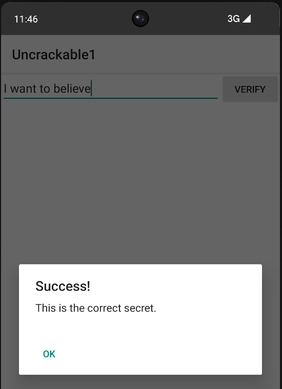
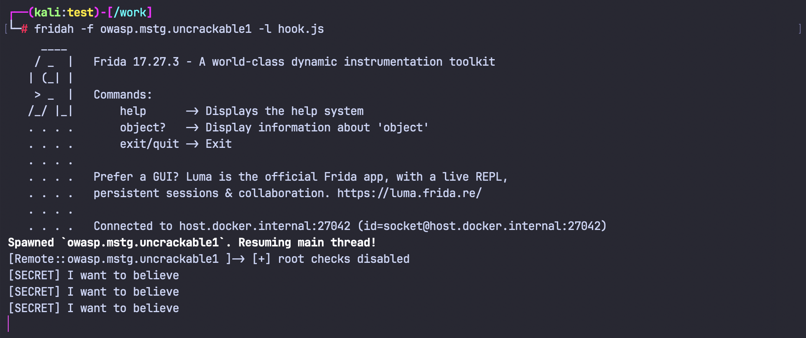

# OWASP UnCrackable Level 1: Root Detection Bypass and Secret Extraction with Frida

Write up by Patryk (Patsec). Android, static analysis with jadx, dynamic analysis with Frida.

## Summary

I bypassed the root detection of OWASP UnCrackable Level 1 with a short Frida hook and then recovered the hidden secret directly from the app's memory at runtime. The app refuses to run on a rooted device, but that check runs on the device the attacker controls, so it can be switched off in a few lines. The secret itself is protected by AES, yet the key and the ciphertext sit side by side in the same class, so the encryption adds no real protection.

| Item | Value |
| --- | --- |
| Target | OWASP MASTG UnCrackable Level 1 (`owasp.mstg.uncrackable1`) |
| APK SHA256 | `1da8bf57d266109f9a07c01bf7111a1975ce01f190b9d914bcd3ae3dbef96f21` |
| Platform | Android 13 emulator (API 33, arm64), rooted adb |
| Tools | jadx 1.5.6, apktool 2.7.0, Frida 17.27.3, adb |
| Result | Root checks bypassed, secret extracted, app accepted it ("Success!") |
| Scope | Public training app built for security education |

## Lab setup

All tooling lives in a Kali Linux Docker container, and only the emulator runs on the host Mac. On Apple Silicon an Android emulator cannot be hardware accelerated inside Docker, but it runs well natively, while the container keeps the toolchain reproducible and disposable.

| Component | Where it runs | Details |
| --- | --- | --- |
| Analysis tools | Kali container (arm64) | adb, jadx, apktool, frida-tools 17.27.3, objection |
| Android emulator | macOS host | Android Studio AVD, API 33, Google APIs image (arm64-v8a), started with `-writable-system` |
| adb server | macOS host | Container reaches it through `ADB_SERVER_SOCKET=tcp:host.docker.internal:5037` |
| frida-server | Inside the emulator | Version 17.27.3, identical to the client, running as root |
| Frida channel | Container to emulator | `adb forward tcp:27042 tcp:27042`, client uses `frida -H host.docker.internal:27042` |

The frida-server version must match the `frida` client version exactly, otherwise the connection closes without a useful error. The server process also does not survive an emulator reboot, so I wrapped the whole bring up (root, version check, push, start, port forward, connectivity test) into one helper script exposed as a single `mobile` command.

## Static analysis

An automated first pass (apktool plus jadx) reported little: `allowBackup="true"` in the manifest, one `Cipher.getInstance` call using AES, and one `Log.d` call. No network endpoints and no exported components. The AES hit was the most interesting lead, so I read the decompiled sources in `sg/vantagepoint`.

### Root detection

Class `sg.vantagepoint.a.c` contains three methods, each returning `true` when the device looks rooted:

- `a()` splits `PATH` and looks for a `su` binary in each directory.
- `b()` checks whether `Build.TAGS` contains `test-keys`.
- `c()` checks for known root artifacts such as `/system/app/Superuser.apk` and `/system/xbin/daemonsu`.

`MainActivity.onCreate` calls them first. If any returns `true`, the app shows a dialog and calls `System.exit(0)` when the user taps OK:

```java
protected void onCreate(Bundle bundle) {
    if (c.a() || c.b() || c.c()) {
        a("Root detected!");
    }
    if (b.a(getApplicationContext())) {
        a("App is debuggable!");
    }
    super.onCreate(bundle);
    setContentView(R.layout.activity_main);
}
```

### Secret validation

The verify button passes the typed text to `sg.vantagepoint.uncrackable1.a.a(String)`, which decrypts a stored value and compares it with the input:

```java
public static boolean a(String str) {
    byte[] bArrA;
    byte[] bArr = new byte[0];
    try {
        bArrA = sg.vantagepoint.a.a.a(
            b("8d127684cbc37c17616d806cf50473cc"),
            Base64.decode("5UJiFctbmgbDoLXmpL12mkno8HT4Lv8dlat8FxR2GOc=", 0));
    } catch (Exception e) {
        Log.d("CodeCheck", "AES error:" + e.getMessage());
        bArrA = bArr;
    }
    return str.equals(new String(bArrA));
}
```

The 128 bit key and the ciphertext are hardcoded in the same file. The plaintext secret exists in memory on every verification, as the return value of `sg.vantagepoint.a.a.a`.

## Bypassing root detection

Assigning a function to `implementation` in Frida swaps the body of a Java method at runtime. I replaced the three detection methods with versions that always answer "not rooted":

```javascript
Java.perform(function () {
  var c = Java.use("sg.vantagepoint.a.c");
  c.a.implementation = function () { return false; };
  c.b.implementation = function () { return false; };
  c.c.implementation = function () { return false; };
  console.log("[+] root checks disabled");
});
```

The app is launched in spawn mode so the script is loaded before `onCreate` runs:

```bash
frida -H host.docker.internal:27042 -f owasp.mstg.uncrackable1 -l hook.js
```

With the hook in place the "Root detected!" dialog never appeared and the app showed its normal input screen.

## Extracting the secret

I hooked the AES decryption function and printed its return value. The app does the hard work itself on every verification, so I only had to observe the result:

```javascript
var a = Java.use("sg.vantagepoint.a.a");
a.a.implementation = function (key, data) {
  var res = this.a(key, data);   // call the original decrypt
  console.log("[SECRET] " + Java.use("java.lang.String").$new(res));
  return res;                    // return it unchanged
};
```

I typed any text into the field and tapped VERIFY. The console printed the plaintext secret, `I want to believe`. Typing it into the field returned "Success! This is the correct secret." Since key and ciphertext are both in the APK, the value could also be recovered offline with any AES library.

### Evidence



*Figure 1. The emulator accepts the recovered secret.*



*Figure 2. Frida session from the Kali container: spawn, root bypass confirmation and the extracted secret, printed once per verification.*

## Findings

UnCrackable is a training target, so these ratings describe how each issue would be classified if it protected a real asset.

| ID | Finding | MASVS | CWE | Severity |
| --- | --- | --- | --- | --- |
| F1 | Root detection implemented only on the client and bypassable at runtime | MASVS-RESILIENCE | CWE-693 | Low |
| F2 | AES key and ciphertext hardcoded in the same class | MASVS-CRYPTO | CWE-321 | Medium |
| F3 | Secret recoverable from memory during runtime verification | MASVS-CRYPTO, MASVS-RESILIENCE | CWE-602 | Medium |
| F4 | Application backup allowed (`allowBackup="true"`) | MASVS-STORAGE | CWE-530 | Low |

## Remediation

1. Validate secrets and licences on a server. Never ship the value, or a reversible form of it, inside the app.
2. If a local secret is unavoidable, keep the key in the Android Keystore with hardware backing and use an authenticated mode such as AES-GCM.
3. Treat root detection as a risk signal, not a gate. Use the Play Integrity API with server side verification, combine several independent checks, and obfuscate with R8.
4. For high value apps add runtime protection that detects instrumentation such as Frida, and accept that it slows an attacker down but does not stop one.
5. Set `allowBackup="false"` unless backups are required.

## Takeaways

- Static analysis first saves time. Reading the decompiled code showed exactly which methods to hook, so the Frida part was a few lines.
- Client side protections are speed bumps. The useful question in a real engagement is what the bypass leads to: tokens, API traffic, or business logic the server never re-checks.
- A reproducible lab matters. Tooling in a container, emulator on the host and one command to bring Frida up made each new target cheap to start.

Next: UnCrackable Level 2 (native code), then a real open source Android application.

## References

- OWASP MASTG UnCrackable Apps
- OWASP MASVS
- Frida documentation
